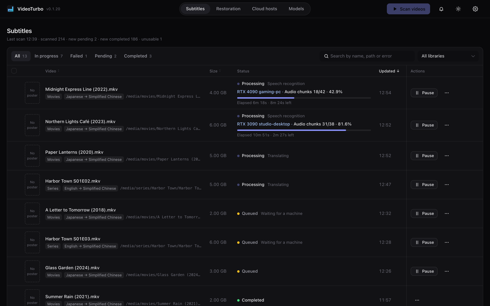
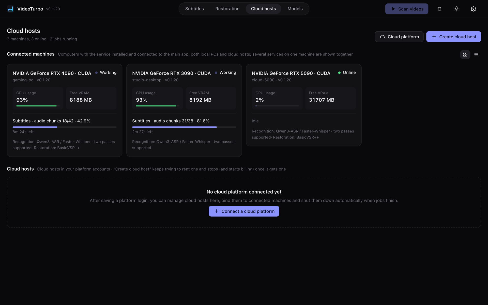
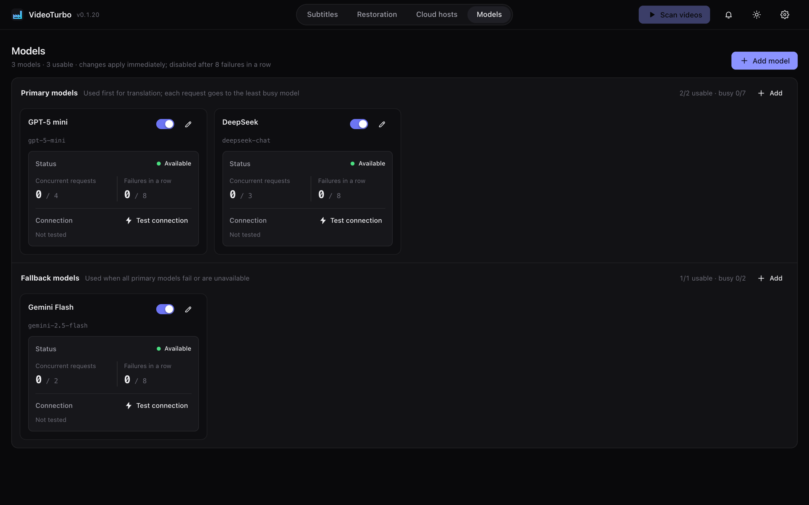

import { Card, CardGrid } from '@astrojs/starlight/components';

## Features

<CardGrid>
	<Card title="Automatic subtitles" icon="translate">
		Japanese, English or Korean → Simplified Chinese, Traditional Chinese, English and more, with a language pair per library.
	</Card>
	<Card title="Skips what it doesn't need" icon="approve-check">
		Videos that already have a target-language subtitle are marked completed; videos with source-language text subtitles are translated without speech recognition.
	</Card>
	<Card title="Web dashboard" icon="laptop">
		Scan, submit, pause and retry from the browser, in English or Simplified Chinese.
	</Card>
	<Card title="Several machines at once" icon="rocket">
		Home PCs and on-demand cloud GPUs can all join; jobs are shared out automatically and cloud hosts shut down when they finish.
	</Card>
	<Card title="Optional" icon="puzzle">
		AI video restoration, cloud storage libraries, Emby / Jellyfin refresh, webhook notifications and plugins.
	</Card>
</CardGrid>

## Screenshots

| Connected machines and cloud hosts | Translation models |
| --- | --- |
|  |  |
