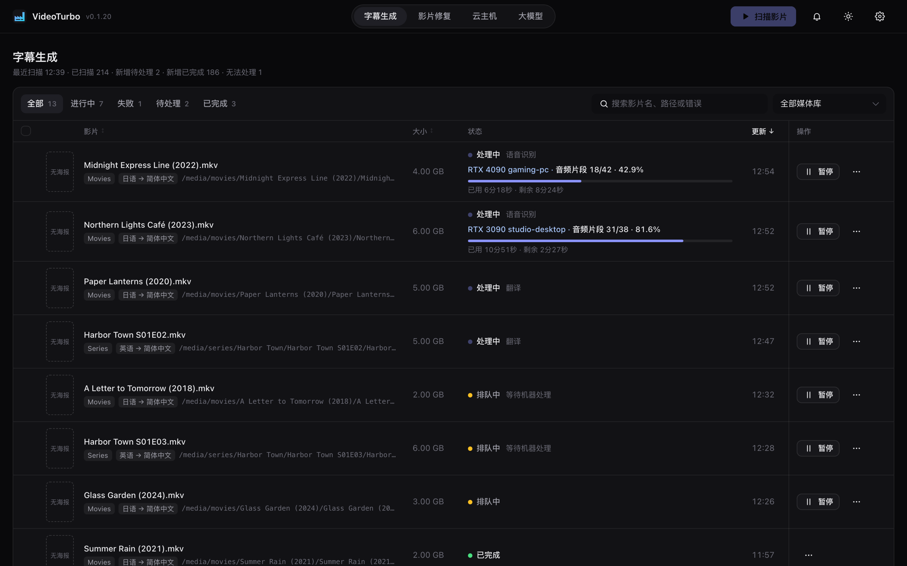
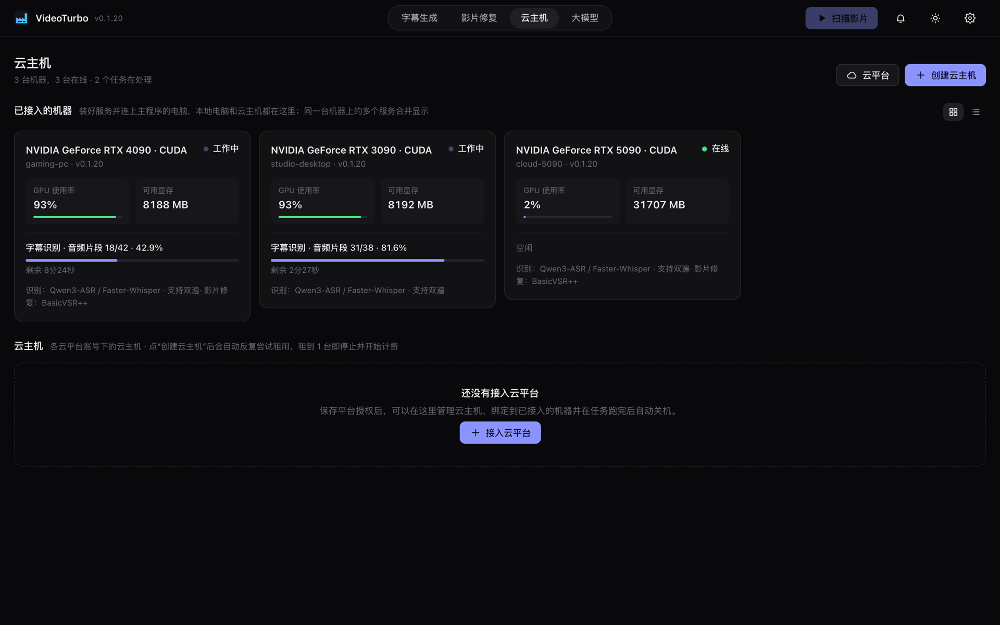
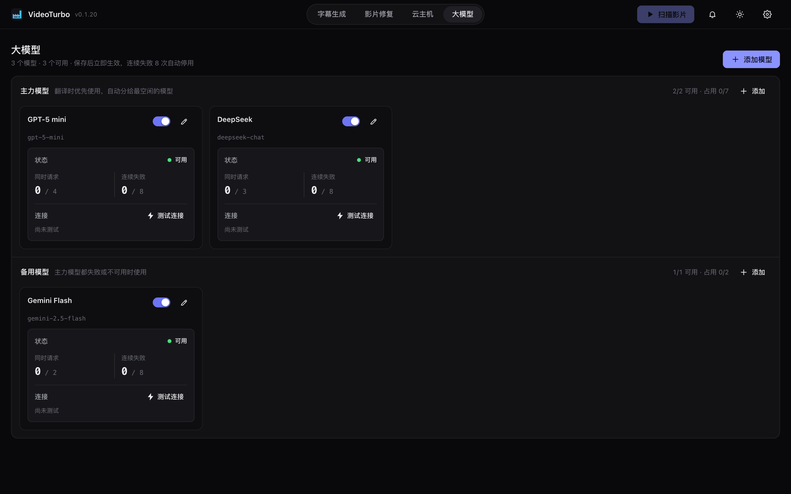

import { Card, CardGrid } from '@astrojs/starlight/components';

## 功能

<CardGrid>
	<Card title="自动生成字幕" icon="translate">
		日语、英语、韩语影片 → 简体中文、繁体中文、英语等，每个媒体库单独选语言。
	</Card>
	<Card title="跳过不需要的影片" icon="approve-check">
		已有目标语言字幕的直接记为已完成；自带原文字幕的只翻译、不识别。
	</Card>
	<Card title="网页控制台" icon="laptop">
		扫描、提交、暂停、重试都在浏览器里完成，界面支持简体中文和英文。
	</Card>
	<Card title="多台机器一起干活" icon="rocket">
		家里的游戏本、台式机或按需租用的云 GPU 都能接入，任务自动分配，云主机跑完自动关机。
	</Card>
	<Card title="可选功能" icon="puzzle">
		AI 影片修复、网盘媒体库、Emby / Jellyfin 自动刷新、Webhook 推送，以及插件扩展。
	</Card>
</CardGrid>

## 界面

| 已接入的机器与云主机 | 翻译模型 |
| --- | --- |
|  |  |
